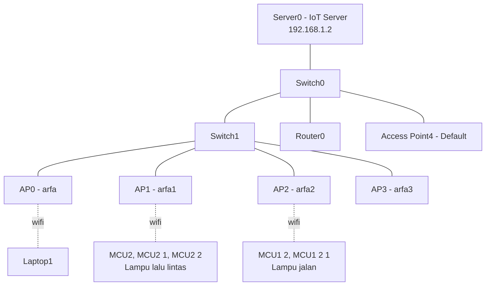

# Smart City IoT – Cisco Packet Tracer

Simulasi **Smart City berbasis IoT** di Cisco Packet Tracer: lampu jalan otomatis bertenaga surya/angin, lampu lalu lintas pertigaan, serta otomasi keamanan, kebakaran, banjir, dan akses pintu melalui **IoT Server**.

- File proyek: `iot project.pkt`
- Versi Packet Tracer: 8.2.2

## Ringkasan

| Komponen | Jumlah / Keterangan |
|---|---|
| Server (IoT/IoE server) | 1 (`Server0`, 192.168.1.2/24) |
| Router | 1 (ISR4331) |
| Switch | 2 (2960-24TT) |
| Access Point | 5 (SSID `arfa`, `arfa1`, `arfa2`, `arfa3`, `Default`) |
| MCU (IoT MCU-PT) | 5: 2 pengendali lampu jalan, 3 pengendali lampu lalu lintas |
| Laptop | 1 (terhubung ke SSID `arfa`) |

## Topologi

Semua MCU terhubung ke IoT Server (`192.168.1.2`) lewat WiFi (mode *Remote Server*), dengan gateway `192.168.1.1`.

## Skenario

### 1. Lampu jalan otomatis (MCU1(2), MCU1(2)(1))

Tiap MCU membaca **photo sensor** di `A0` dan mengendalikan **5 lampu jalan** di `D1–D5`. Lampu menyala saat intensitas cahaya di bawah ambang batas gelap dan mati saat sudah terang (dengan histeresis supaya tidak berkedip).

Sumber daya: **Solar Panel / Wind Turbine → Power Meter → Battery**, terhubung ke MCU yang sama.

### 2. Lampu lalu lintas pertigaan (MCU2, MCU2(1), MCU2(2))

Tiap MCU mengatur **3 lampu RGB** (merah dan hijau per arah, pin `D0–D5`) dengan siklus tetap: hijau satu arah, transisi kuning (kedip), lalu arah berikutnya. Durasi hijau dan kuning bisa diubah di bagian `CONFIG` pada program.

### 3. Otomasi IoT Server (IoE rules)

| Rule | Kondisi | Aksi |
|---|---|---|
| cctv1–6 | Motion sensor mendeteksi gerak (3 sensor) | Webcam (CCTV) pasangannya menyala; mati saat tidak ada gerak |
| trip1–2 | Trip sensor aktif | Siren menyala; mati saat nonaktif |
| rfid valid / invalid | ID kartu RFID dikenali / tidak dikenali | Status reader diatur |
| rfid unlock / lock | Status reader valid / invalid | Pintu dibuka / dikunci |
| ac, ac2 | Suhu di atas / di bawah ambang batas | AC menyala / mati |
| humiture1–2 | Kelembapan tinggi / rendah | Penyiram rumput mati / menyala |
| fire1–2 | Fire monitor mendeteksi api | 4 fire sprinkler menyala; mati saat aman |
| water drain / water drain1 | Level air di atas / di bawah ambang batas | 3 saluran pembuangan air menyala / mati |

Perangkat yang dipakai: Motion Detector ×3, Webcam ×3, Trip Sensor, Siren, RFID Reader, RFID Card ×2, Door, Temperature Monitor, Air Conditioner, Humiture Monitor, Lawn Sprinkler, Fire Monitor, Fire Sprinkler ×4, Water Level Monitor, Water Drain ×3.

## Jaringan

- Server `192.168.1.2/24`, gateway `192.168.1.1`.
- SSID per area: `arfa` (laptop), `arfa1` (lampu lalu lintas), `arfa2` (lampu jalan), `arfa3`.
- Switch0 ke Router0 dan Switch1 menggunakan port trunk.

## Catatan

1. Konfigurasi Router0 belum terisi (interface `Gi0/0/0` belum punya IP), padahal gateway MCU diarahkan ke `192.168.1.1`.
2. Akun IoT Server masih memakai kredensial default. Ganti jika dipakai di luar lab.
3. Ambang batas sensor pada program MCU dan IoE rules bisa disesuaikan sesuai kebutuhan simulasi.

## Cara Menggunakan

1. Buka `iot project.pkt` dengan Cisco Packet Tracer 8.2.2 atau lebih baru.
2. Pastikan semua MCU dan laptop terhubung ke SSID masing-masing.
3. Ubah kondisi lingkungan (cahaya, suhu, gerakan, api, level air) di mode simulasi untuk melihat aturan IoT bekerja.
